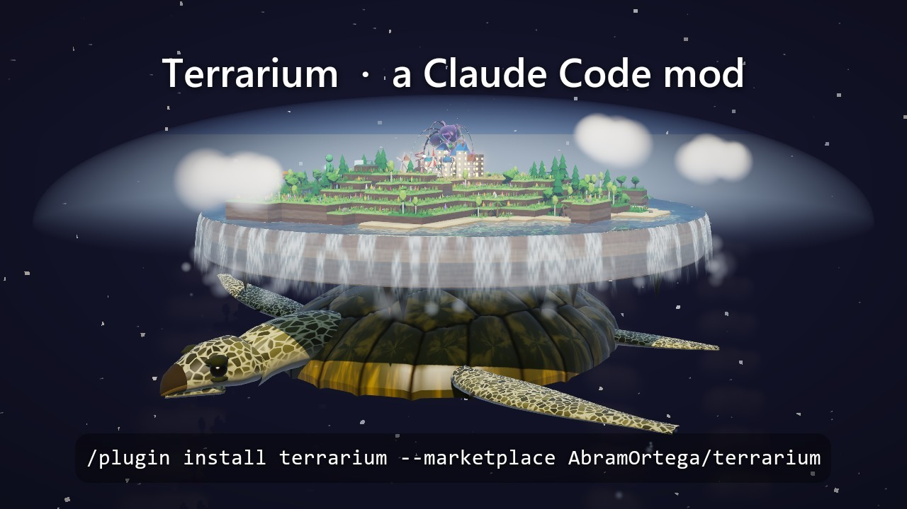
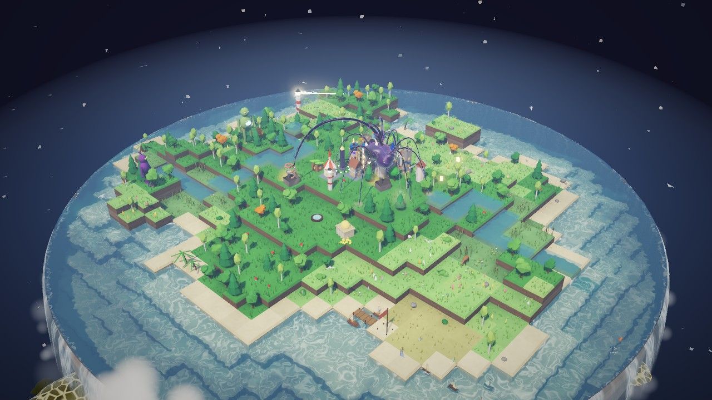
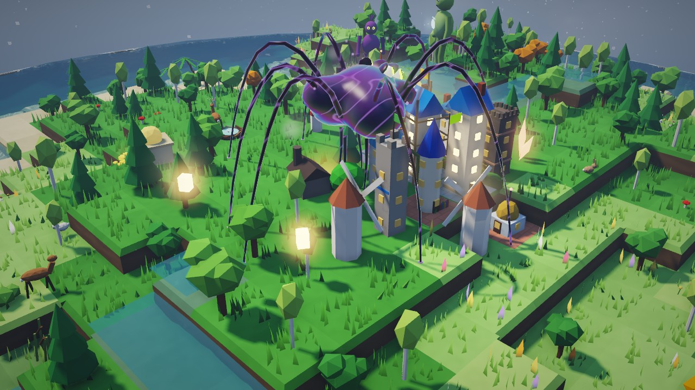

# Terrarium

**Your Claude Code conversation, drawn as a living island on the back of a turtle swimming through space.**

[](docs/trailer.mp4)

▶ [Watch the 15-second trailer](docs/trailer.mp4)

Terrarium is a Claude Code mod. Every prompt you type, every tool Claude calls and every file it touches becomes part of the island. Each prompt raises a hill. Files Claude writes become houses in a town, files it reads become trees, shell commands become forges and searches become beacons. A creature crawls between the files Claude is working on. The weather, tide, clouds and sky follow the session as it happens.

Nothing is decoration: every visual stands for something real about your session or your machine.

| The 3D window | The creature at work |
| --- | --- |
|  |  |

## Install

At the prompt of a Claude Code session in a terminal, type:

```
/plugin install terrarium --marketplace AbramOrtega/terrarium
```

Answer `y` to add the marketplace, then press Enter for the user scope. The island starts with your next prompt.

Installed at the user scope from a terminal, it also loads in the Claude desktop app's Code tab.

## Using it

The island opens in a pane beside the conversation.

| Command | What it does |
| --- | --- |
| `/terrarium` | Show the island in the pane |
| `/terrarium full` | Open the island in 3D in your browser, at http://localhost:47615 |
| `/terrarium wide` / `narrow` | Change the pane's size |
| `/terrarium hide` | Put the pane away |
| `/terrarium save` | Save the current drawing as an SVG |
| `/terrarium photo` | Render a postcard of the island in Blender |
| `/terrarium reset` | Start a new island |



### The 3D window

| Do this | And this happens |
| --- | --- |
| Drag | Pan across the island |
| Right-drag or Shift-drag | Turn the view, even down below the rim |
| Scroll | Zoom in and out |
| Click the ground | The creature crawls there, then goes back to its work after 20 seconds |
| Double-click | Go back to the island view |
| `U` | Fly out to see the turtle, and back |
| `O` | Slowly orbit the island |
| `T` | Miniature focus: the creature sharp, everything else soft |
| `A` | Turn the glow of air over the disc on or off |
| `C` | Open the chat, to read the conversation and message Claude from the window |
| `N` | Show or hide labels |
| `L` | Show the legend: what everything means |
| `H` | Show the chronicle of the session |
| `M` | Turn sound on or off |
| `Q` | Change the graphics quality |
| `F` | Go fullscreen |

## What you're looking at

| On the island | What it shows |
| --- | --- |
| 🕷 The creature | Claude. It hatches with your first prompt. Its legs grow with the turn's running time, its body with the tokens it uses, and it grows an eye as it works. It sleeps when the turn ends and watches you while it waits for you. |
| 🐣 Spawnlings | Subagents. Their colour shows the agent type and their eyes show the model. |
| ⌂ Buildings | Files Claude wrote or edited. Each language has its own architecture, and each file has a floor for every time its size doubles. Edits paint bands in the walls. Cranes are TODOs and boarded windows are FIXMEs. |
| ♣ ▲ † × ◍ ◊ Π | Reads, shell commands, searches, the web, subagents, MCP servers and skills: trees, forges, beacons, windmills, nests, crystals and shrines. |
| 🛣 Streets | Imports between files |
| 🐞 Bugs, 🌋 volcano | Failed tool calls. The volcano wakes once errors pile up. |
| 🌊 Tide, 🌧 rain | How full the context is. Rain starts at 70%. |
| ☀ Sun, ☾ moon | Your session limit and your weekly limit |
| ☁ Clouds, waves, rivers | CPU, RAM and disk activity |
| 👣 Giants | Each program using more than 2% of the CPU |
| ⚓ Harbor | Git, for projects with a remote: ships for push and pull, fireworks for a commit |
| ¤ Treasury | What the session's tokens would cost at API prices. If you're on a subscription, it isn't a bill. |
| 🐢 The turtle | The conversation's pace. It swims hard while Claude thinks, paddles while tools run, calls at each new prompt and draws its head in while you're away. |

The full legend is in the pane and in the 3D window (`L`).

## Requirements

- **Claude Code** with mod support. Terrarium was built against Claude Code 2.1.295.
- **Windows** for everything. The 3D window's local server and the readings of the machine (CPU, RAM, disk, GPU and giants) use Windows PowerShell. On macOS and Linux the pane works and the 3D window opens from a file, but that is untested.
- **A browser with WebGL2** for the 3D window.
- **[Blender](https://www.blender.org/)** (optional), for `/terrarium photo`. Terrarium looks for it in `C:\Program Files\Blender Foundation`, or you can set `BLENDER` to its path.

## Privacy

- **Everything stays on your machine.** The 3D window is served from `localhost:47615` only, and uploads to it are checked by their Origin.
- **File contents are never stored or shown.** Terrarium reads the files Claude touches only to count things: lines, TODOs and imports.
- **To read the session and the machine**, it runs `git status` and `git log` (only in projects with a remote) and Windows PowerShell for the machine's readings.
- **The 3D window's chat box sends what you type to Claude Code as your own message.**

## Development

```bash
git clone https://github.com/AbramOrtega/terrarium
claude --plugin-dir ./terrarium
```

```bash
claude plugin test ./terrarium
```

```bash
claude plugin validate ./terrarium
```

| Path | What's there |
| --- | --- |
| `hooks/register.tsx` | The mod: hooks, the pane, the `/terrarium` command and the 3D window's server |
| `hooks/world.ts` | The world model: how events turn into the island |
| `hooks/render-svg.ts` | The pane's isometric drawing |
| `viewer/` | The 3D window, in WebGL2, with no dependencies |
| `scripts/photo.py` | The Blender postcard renderer |
| `scripts/make_sounds.py` | Makes the sound effects in `sounds/` (Python and numpy) |
| `tests/` | Tests for `claude plugin test` |

## License

[MIT](LICENSE)
